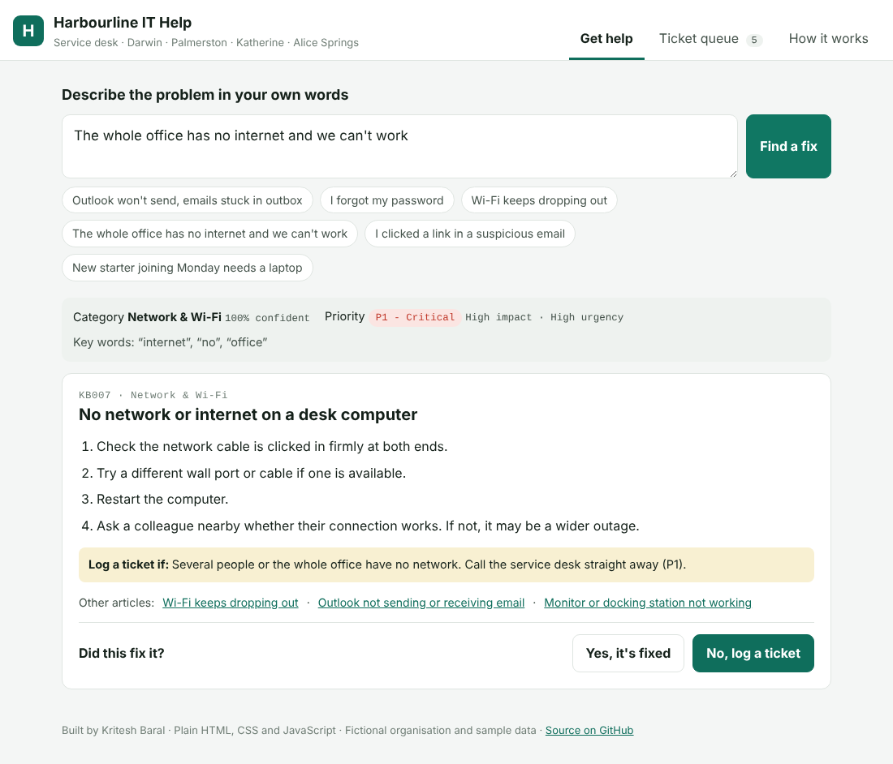

# Harbourline IT Help: an offline helpdesk assistant

A self-service IT help tool that **finds the right fix, triages tickets automatically and tracks them against SLA**, using machine learning that runs entirely in the browser. No AI service, no API key, no server, no running cost.

**Live app:** https://kriteshbaral.github.io/helpdesk-assistant/



## Why I built it

My [service desk analytics project](https://github.com/kriteshbaral/service-desk-analytics) found that at the fictional organisation Harbourline Regional Services:

- **23% of all tickets** were password, lockout or MFA resets, mostly by phone
- remote sites waited much longer for help
- tickets that missed SLA scored 2.83/5 for satisfaction against 4.20

This app is the fix those findings point to: staff solve common problems themselves, and the tickets that do reach the service desk arrive already sorted and prioritised.

## What it does

| Feature | How it works |
|---|---|
| **Finds a fix** | Matches the user's own words against 20 knowledge-base articles with **BM25**, the ranking formula used by search engines |
| **Predicts the category** | A **Naive Bayes classifier** trained on 224 labelled tickets picks one of 8 categories and reports its confidence |
| **Explains itself** | Shows which words drove the prediction, and flags low-confidence results for a human to check |
| **Security safety net** | Clear security words (phishing, hacked, stolen…) override the model, because a missed incident costs more than a false alarm |
| **Sets the priority** | Applies the **ITIL impact × urgency matrix** to phrases like "whole office" or "can't work" to assign P1 to P4 |
| **Tracks SLA** | A ticket queue with live due times, at-risk and overdue flags, using the same SLA targets as the analytics project |

## Results

Measured with **4-fold cross-validation**: every ticket is predicted by a model that never saw it during training.

| | Accuracy |
|---|---|
| Random guessing (8 categories) | 12.5% |
| Naive Bayes model | **79.9%** |
| Model + security safety net | **83.5%** |

Security recall rose from **50% to 79%** with the safety net. The safety-net words were written after reading the examples, so on brand-new tickets its benefit will probably be smaller. The live app recomputes all of these figures in your browser on the *How it works* tab.

### What I tried, and what worked

| Change | Cross-validated accuracy |
|---|---|
| Starting point: 144 examples, word pairs included | 60% |
| Also train on knowledge-base article text | 76% |
| Single words only (word pairs added noise with this little data) | 79% |
| 224 examples | 80% |
| Add security safety net | 83.5% |

## Run it yourself

Open `index.html` in any browser. No install or build step.

```bash
node tests/run_tests.js    # 28 tests: data checks, search, priority rules, classifier accuracy
```

## Project structure

```
index.html          page structure
css/styles.css      design (light and dark themes, works on phones)
js/kb.js            20 knowledge-base articles
js/training.js      224 labelled example tickets
js/nlp.js           tokeniser, BM25 search, Naive Bayes, ITIL priority, evaluation
js/app.js           page logic: help flow, ticket form, SLA queue
tests/run_tests.js  automated tests
```

## Skills demonstrated

- **IT service management (ITIL):** incident categorisation, impact × urgency prioritisation, SLAs, knowledge management, self-service deflection
- **Machine learning:** text classification, Laplace smoothing, softmax confidence, cross-validation, precision and recall
- **Information retrieval:** BM25 ranking, tokenising, stemming, synonyms
- **Front-end development:** accessible HTML, CSS and JavaScript with no frameworks
- **Testing:** an automated test suite with no dependencies

## Limits

- Ticket data is stored only in your own browser (localStorage). A real deployment would connect to a service desk tool such as ServiceNow or Jira Service Management.
- The training examples are written by me, not real tickets, so real-world accuracy would need checking on live data.

---

Built by **Kritesh Baral** · [LinkedIn](https://linkedin.com/in/kriteshbaral) · [GitHub](https://github.com/kriteshbaral)
